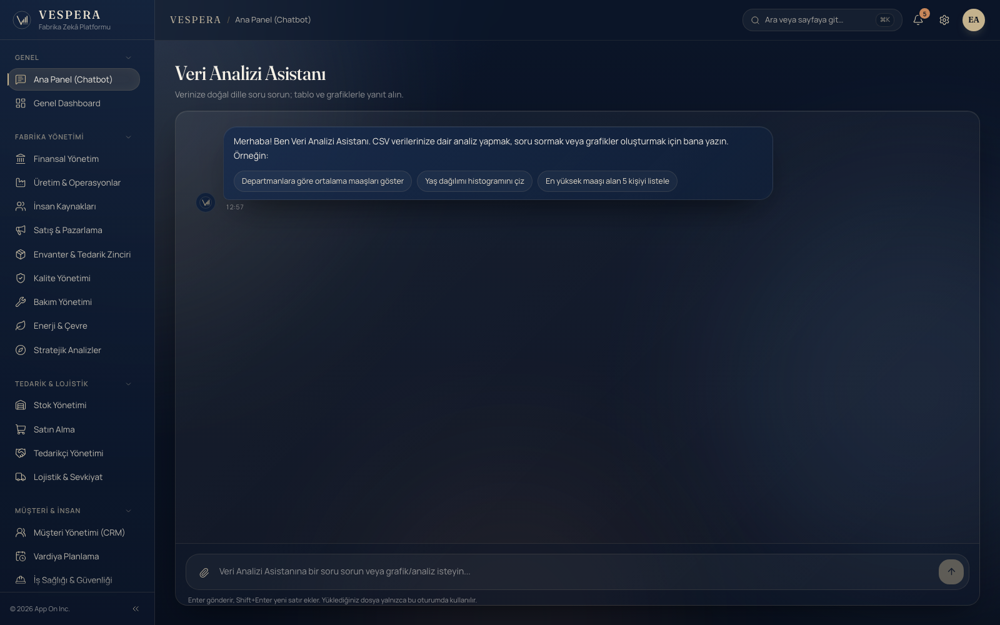
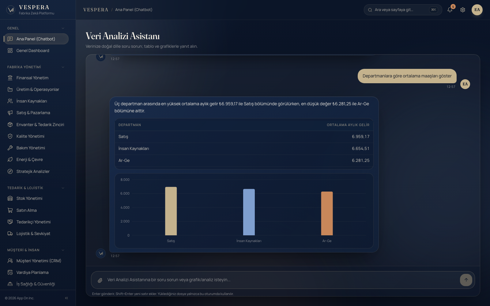
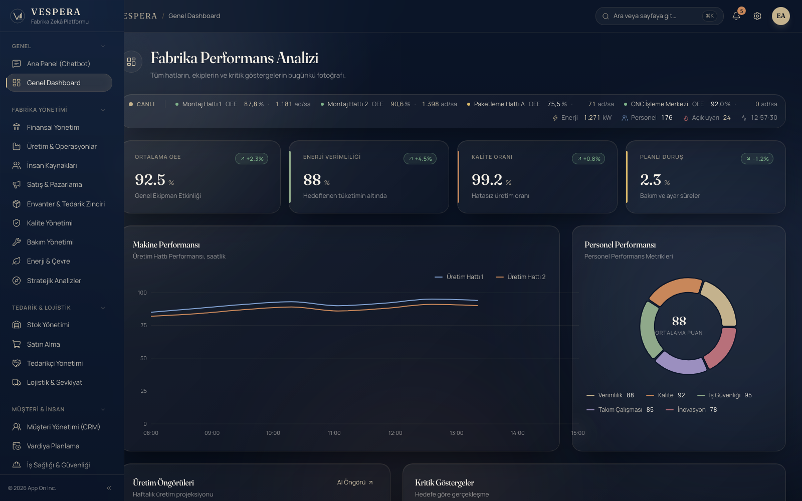
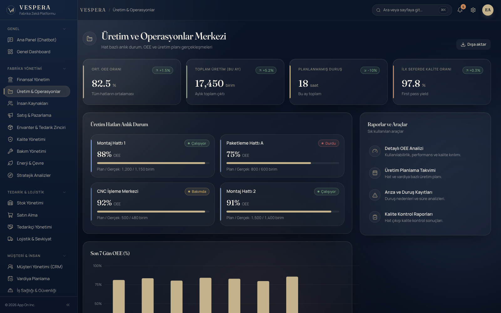
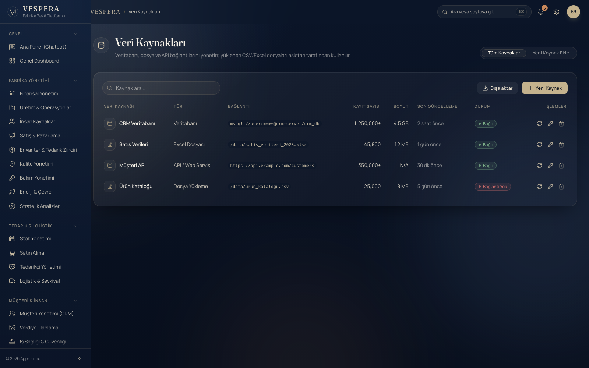
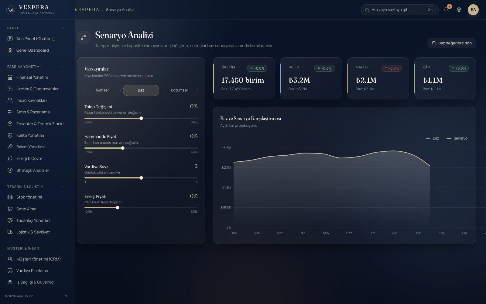
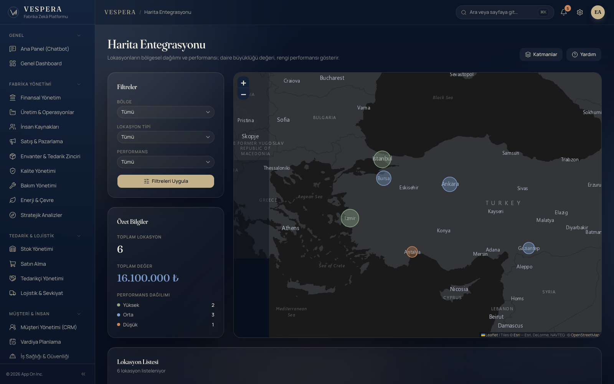
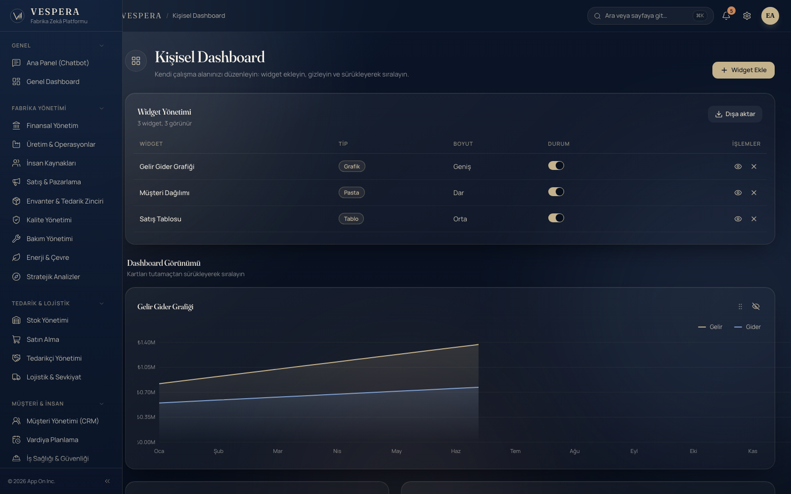
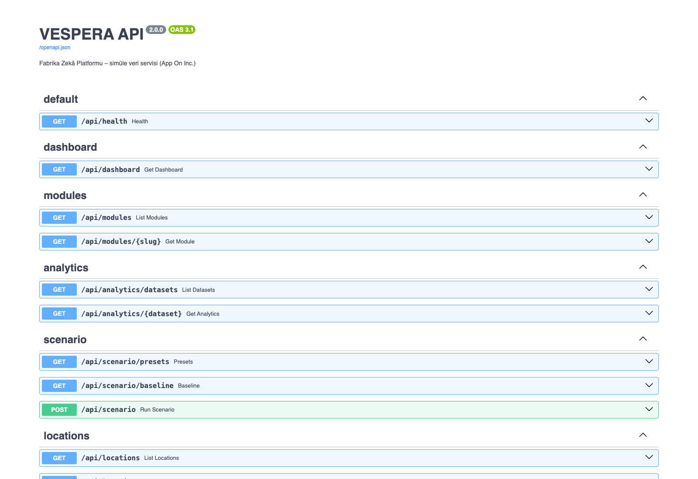
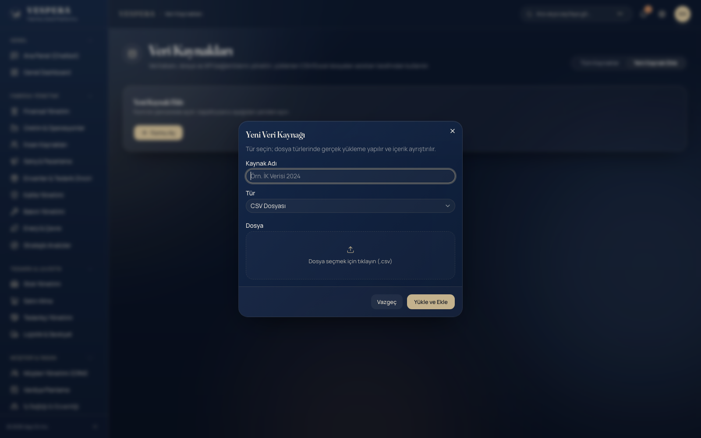

<div align="center">


# VESPERA · Fabrika Zekâ Platformu

**39 modüllü fabrika yönetimi, operasyon zekâsı ve doğal dilde veri analizi platformu.**

Next.js 16 · React 19 · Tailwind CSS 4 · FastAPI · pandas · Recharts · Leaflet

[Özellikler](#özellikler) · [Ekran Görüntüleri](#ekran-görüntüleri) · [Hızlı Başlangıç](#hızlı-başlangıç) · [Veriye Bağlanma](#veriye-bağlanma) · [API ve Swagger](#api-ve-swagger) · [Dağıtım](#statik-yayın-ve-demo-modu)

</div>

---

VESPERA; üretimden finansa, insan kaynaklarından tedarik zincirine kadar bir fabrikanın tüm operasyonlarını tek bir lacivert-bej, cam işçilikli arayüzde toplayan bir referans uygulamasıdır. Frontend statik olarak da yayınlanabilir; backend ise gerçek CSV/Excel dosyaları üzerinde pandas ile analiz yapar, isteğe bağlı olarak OpenAI uyumlu bir LLM'e bağlanır, PDF üretir ve e-posta gönderir.

Proje, `video/reference.mp4` referans alınarak yeniden tasarlanmıştır. Tasarım dili, ürün spesifikasyonu ve ekran bazlı detaylar için [`docs/SPEC.md`](docs/SPEC.md) dosyasına bakın.

## Özellikler

- **39 operasyonel modül** — Finans, üretim, İK, satış, envanter, kalite, bakım, enerji, strateji, stok, satın alma, tedarikçiler, lojistik, CRM, vardiya, İSG, varlıklar, AI öngörü, KPI, uyarılar, denetim, belgeler, entegrasyonlar, üretim planlama, reçeteler (BOM), izlenebilirlik, IoT, dijital ikiz, kalibrasyon, yedek parça, maliyet, bütçe, CAPEX, ESG, risk & uyum, çoklu tesis, Ar-Ge, eğitim ve şikâyet yönetimi.
- **Genel Dashboard** — OEE, enerji verimliliği, kalite ve duruş KPI'ları; canlı hat şeridi; üretim hattı grafiği; personel performans donut'u; üretim öngörüsü; kritik göstergeler.
- **Veri Analizi Asistanı** — Türkçe doğal dilde soru sorun; tablo ve grafiklerle yanıt alın. LLM anahtarı varsa OpenAI uyumlu model pandas kodu üretir ve sandbox'ta çalıştırır; anahtar yoksa yerleşik Türkçe kural motoru devreye girer.
- **CSV / Excel yükleme** — Sürükle-bırak veya dosya seç; pandas ile ayrıştırılan veri anında sohbette kullanılır. Demo modunda CSV tarayıcıda işlenir.
- **Detaylı analiz** — Veri seti seçimi, tarih aralığı, gruplama, zaman serisi, özet istatistik ve korelasyon ısı haritası.
- **Senaryo analizi** — Talep, hammadde fiyatı, vardiya sayısı ve enerji fiyatı slider'larıyla baz vs senaryo karşılaştırması; 350 ms gecikmeli canlı hesap.
- **Harita** — Leaflet üzerinde 6 lokasyon, bölge/tip/performans filtreleri, özet değerler ve lokasyon tablosu.
- **Kişisel dashboard** — Widget ekleme, gizleme, sürükle-bırak sıralama; geniş/orta/dar boyutlar.
- **Tema stüdyosu** — Renkleri canlı CSS değişkenlerine uygulama, hazır temalar, localStorage kalıcılığı.
- **Yönetim ekranları** — Kullanıcı/rol matrisi, rapor oluşturma ve PDF indirme, zamanlanmış e-posta, veri kaynakları, bildirim merkezi ve denetim günlüğü.
- **Demo modu** — `NEXT_PUBLIC_API_URL` boş bırakıldığında backend olmadan tüm modüller, sohbet, tema, widget ve raporlar yerleşik örnek veriyle çalışır.
- **Statik dışa aktarma** — `npm run build` ile `out/` klasörü üretilir; Hostinger, Netlify, GitHub Pages gibi herhangi bir statik sunucuda yayınlanabilir.

## Ekran Görüntüleri

Aşağıdaki görüntüler bu depodaki uygulamanın yerel çalıştırmasından alınmıştır.

### Ana Panel — Veri Analizi Asistanı



### Sohbet yanıtı — tablo + grafik



### Genel Dashboard



| Üretim & Operasyonlar | Veri Kaynakları |
|:---:|:---:|
|  |  |

| Senaryo Analizi | Harita Entegrasyonu |
|:---:|:---:|
|  |  |

| Kişisel Dashboard | Swagger / OpenAPI |
|:---:|:---:|
|  |  |

## Mimari

```text
┌─────────────────────────────────────────────────────────────┐
│  frontend/  Next.js 16 · App Router · React 19 · Tailwind 4 │
│  Statik export (out/) veya dev sunucusu (port 3005)         │
│  NEXT_PUBLIC_API_URL ile backend'e bağlanır                 │
└───────────────────────────┬─────────────────────────────────┘
                            │ HTTP / JSON
┌───────────────────────────▼─────────────────────────────────┐
│  backend/  FastAPI (port 8000, prefix /api)                 │
│  ├── Bellek içi store + seed verisi (39 modül)              │
│  ├── pandas: CSV/XLSX ayrıştırma, analiz, korelasyon        │
│  ├── OpenAI uyumlu LLM (opsiyonel) + güvenli kod sandbox'ı  │
│  ├── reportlab: Türkçe karakterli PDF                       │
│  └── smtplib: gerçek veya simüle e-posta                    │
└─────────────────────────────────────────────────────────────┘
```

- Frontend: `frontend/` — Next.js App Router, TypeScript, Tailwind CSS 4, shadcn/base-ui bileşenleri, Recharts, react-leaflet, Zustand.
- Backend: `backend/` — FastAPI, pandas, numpy, openpyxl, reportlab, openai, python-dotenv.
- Spesifikasyon: `docs/SPEC.md` — videodan çıkarılan ekran ve API sözleşmesi.
- Referans video: `video/reference.mp4`; ekran kareleri `video/key/` altında.

## Hızlı Başlangıç

### Gereksinimler

| Araç | Sürüm |
|---|---|
| Node.js | **20.9+** (önerilen 22 LTS) |
| npm | 10+ |
| Python | **3.12** |
| Git | 2.40+ |

### 1. Depoyu klonlayın

```bash
git clone https://github.com/aerdincdal/vespera.git
cd vespera
```

### 2. Backend'i kurun

```bash
cd backend
python3.12 -m venv .venv
source .venv/bin/activate          # Windows: .venv\Scripts\activate
pip install -r requirements.txt
cp .env.example .env               # isteğe bağlı: LLM / SMTP anahtarları
```

Backend'i başlatın:

```bash
uvicorn app.main:app --reload --port 8000
```

Kontrol:

```bash
curl http://localhost:8000/api/health
# {"status":"ok"}
```

### 3. Frontend'i kurun

Yeni bir terminalde:

```bash
cd frontend
npm ci
cp .env.example .env.local         # NEXT_PUBLIC_API_URL=http://localhost:8000
npm run dev
```

Frontend: **http://localhost:3005**

### 4. Tek komutla çalıştırma

Kurulumlar tamamlandıktan sonra kök dizinden:

```bash
./dev.sh
```

`dev.sh`, backend'i `8000`, frontend'i `3005` portunda başlatır; `Ctrl+C` ikisini birlikte kapatır.

### Adresler

| Servis | Adres |
|---|---|
| Frontend | http://localhost:3005 |
| Backend health | http://localhost:8000/api/health |
| **Swagger UI** | **http://localhost:8000/docs** |
| ReDoc | http://localhost:8000/redoc |
| OpenAPI JSON | http://localhost:8000/openapi.json |

> Port 8000 doluysa backend'i `--port 8010` ile başlatıp frontend'i `NEXT_PUBLIC_API_URL=http://localhost:8010 npm run dev` şeklinde çalıştırabilirsiniz.

## Yapılandırma

### Backend ortam değişkenleri (`backend/.env`)

`backend/.env.example` dosyasını kopyalayarak başlayın. Dosya `.gitignore` ile korunur; gerçek anahtarları commit etmeyin.

| Değişken | Zorunlu | Açıklama |
|---|---|---|
| `OPENAI_API_KEY` | Hayır | Boşsa sohbet yerel Türkçe kural motoruyla çalışır. Doluysa LLM kullanılır. |
| `OPENAI_BASE_URL` | Hayır | OpenAI uyumlu endpoint. Groq için `https://api.groq.com/openai/v1`. Boşsa OpenAI. |
| `OPENAI_MODEL` | Hayır | Ana model. Varsayılan `gpt-4o`; örnek `.env.example` içinde `qwen/qwen3.8-27b`. |
| `OPENAI_MODEL_FALLBACK` | Hayır | Ana model hata verirse denenecek yedek model. |
| `SMTP_SERVER` | Hayır | Boşsa e-posta gönderimi simüle edilir. |
| `SMTP_PORT` | Hayır | Varsayılan `587`. |
| `SMTP_USER` / `SMTP_PASSWORD` | Hayır | SMTP kimlik bilgileri. |
| `SMTP_FROM_EMAIL` | Hayır | Gönderen adresi; boşsa `SMTP_USER` kullanılır. |
| `SMTP_USE_SSL` | Hayır | `true` ise SMTPS (465) kullanılır. |

Örnek LLM yapılandırması (Groq):

```env
OPENAI_API_KEY=gsk_your_key_here
OPENAI_BASE_URL=https://api.groq.com/openai/v1
OPENAI_MODEL=qwen/qwen3.8-27b
OPENAI_MODEL_FALLBACK=openai/gpt-oss-120b
```

> LLM anahtarı yoksa da uygulama tamamen çalışır. Sohbet; ortalama, gruplama, yüzde, top-N, histogram, korelasyon, filtre ve sütun listeleme gibi işlemleri yerel kuralla yapar.

### Frontend ortam değişkenleri (`frontend/.env.local`)

| Değişken | Açıklama |
|---|---|
| `NEXT_PUBLIC_API_URL` | Backend taban adresi. `http://localhost:8000` varsayılan. **Boş bırakılırsa demo modu**: ağ isteği atılmaz, yerleşik örnek veri kullanılır. |
| `NEXT_PUBLIC_TILE_URL` | Opsiyonel: harita döşeme URL'i (varsayılan Esri World Dark Gray Canvas). |
| `NEXT_PUBLIC_TILE_ATTRIBUTION` | Opsiyonel: döşeme atıf metni. |

`NEXT_PUBLIC_*` değişkenleri **build zamanında** gömülür. Statik paket ürettikten sonra API adresini değiştirirseniz yeniden build almanız gerekir.

## Veriye Bağlanma

### 1) Varsayılan veri seti (IBM HR)

Backend açılışta `backend/data/hr_attrition.csv` dosyasını okur ve Türkçe sütun/etiketlerle `backend/data/hr_personel_tr.csv` dosyasına çevirir:

- **1.470 çalışan**, **32 sütun**
- Örnek sütunlar: `Personel No`, `Yaş`, `Ayrılma`, `Departman`, `Aylık Gelir`, `Fazla Mesai`, `İş Memnuniyeti`, `Pozisyon`, `Cinsiyet`, `Kıdem`
- Sohbetin analiz ettiği tam dosya: `GET /api/datasources/default/csv`
- Sütun listesi ve önerilen sorular: `GET /api/chat/welcome`

Varsayılan veriyi değiştirmek için:

```bash
# IBM HR şemasına uygun yeni bir CSV ile değiştirin
cp yeni_personel.csv backend/data/hr_attrition.csv
```

Ardından backend'i yeniden başlatın. Kendi şemanız IBM HR ile uyuşmuyorsa dosyayı **yükleyerek** analiz etmek daha doğrudur (aşağıya bakın).

### 2) Arayüzden CSV / Excel yükleme

İki yol vardır:

1. **Veri Kaynakları → Yeni Kaynak Ekle** (`/veri-kaynaklari`)
2. **Sohbetteki ataç simgesi** (`/`)



Desteklenen dosyalar: `.csv`, `.xlsx`, `.xls`, `.xlsm`, `.txt`, `.tsv` · Maksimum **50 MB**.

Yükleme pandas ile ayrıştırılır; ayırıcı (`;`, `,`, tab) ve kodlama (`utf-8-sig`, `utf-8`, `cp1254`, `latin-1`) otomatik denenir. Yüklenen veri yalnızca o backend oturumunda bellekte tutulur.

### 3) API ile yükleme ve sohbet

```bash
# 1) Dosyayı yükle
curl -X POST http://localhost:8000/api/datasources/upload \
  -F "file=@satis_verileri.csv"

# Yanıt içindeki id'yi alın, örn: "ds-3"
# 2) Yüklenen veri üzerinde sohbet edin
curl -X POST http://localhost:8000/api/chat \
  -H "Content-Type: application/json" \
  -d '{
    "message": "Bölgelere göre toplam satışı göster",
    "history": [],
    "datasourceId": "ds-3"
  }'
```

`datasourceId` verilmezse varsayılan HR veri seti kullanılır.

### 4) Veritabanı / API kaynakları hakkında

`POST /api/datasources` ile `Veritabanı`, `Excel`, `CSV`, `API / Web Servisi` türünde kayıtlar oluşturulabilir. Bu demo sürümünde:

- Kayıt; ad, tür, bağlantı metni ve durum bilgisini tutar.
- `POST /api/datasources/{id}/sync` yalnızca "son güncelleme" bilgisini yeniler; gerçek bir DB/API bağlantısı kurmaz.
- Gerçek analiz, **yüklenen CSV/XLSX** dosyaları veya varsayılan CSV üzerinden yapılır.

Gerçek bir veritabanına bağlanmak için genişletme noktası:

1. `backend/app/services/datasource_service.py` içine kendi connector'ünüzü ekleyin (ör. SQLAlchemy + PostgreSQL).
2. Bağlantı bilgisini `backend/.env` içinde tutun (ör. `DATABASE_URL`).
3. Connector'den dönen `pandas.DataFrame`'i `store.dataframes[datasource_id]` olarak kaydedin.
4. `/api/chat` zaten `datasourceId` ile bu DataFrame'i okuyacaktır.

> Üretimde verinin kalıcı olması için `backend/app/store.py` içindeki bellek içi koleksiyonları gerçek bir veritabanıyla değiştirmeniz gerekir. Mevcut sürümde uygulama yeniden başlatıldığında tüm değişiklikler ve yüklenen dosyalar sıfırlanır.

### 5) LLM'e bağlanma

1. `backend/.env` içine `OPENAI_API_KEY` ve gerekirse `OPENAI_BASE_URL` yazın.
2. Backend'i yeniden başlatın.
3. `GET /api/chat/welcome` yanıtındaki `engine` alanı `llm` olmalıdır.

LLM yolu:

1. Model, Türkçe şema ve soruyu alır; `{"title", "code"}` biçiminde pandas kodu üretir.
2. Kod; `pd`, `np`, `df`, kısıtlı builtin'ler ve 5 saniye zaman aşımıyla sandbox'ta çalışır (import/dosya IO yok).
3. Sonuçtan ikinci kısa çağrıyla Türkçe açıklama yazılır; böylece metindeki sayılar tabloyla tutarlı olur.
4. Ana model hata verirse `OPENAI_MODEL_FALLBACK` denenir; o da olmazsa yerel kural motoruna düşülür.

### 6) E-posta (SMTP)

`SMTP_SERVER` ve `SMTP_USER` boşsa gönderim **simüle** edilir; arayüz `simulated: true` yanıtı gösterir. Gerçek gönderim için:

```env
SMTP_SERVER=smtp.example.com
SMTP_PORT=587
SMTP_USER=raporlar@example.com
SMTP_PASSWORD=your_password
SMTP_FROM_EMAIL=raporlar@example.com
SMTP_USE_SSL=false
```

## API ve Swagger

Backend, FastAPI'nin otomatik dokümantasyonunu sunar:

- **Swagger UI:** http://localhost:8000/docs
- **ReDoc:** http://localhost:8000/redoc
- **OpenAPI JSON:** http://localhost:8000/openapi.json

Swagger'da bir uç seçip **Try it out → Execute** ile isteği tarayıcıdan deneyebilirsiniz. `POST /api/chat` ve `POST /api/scenario` gibi uçlarda request body'yi düzenleyip yanıtı canlı görebilirsiniz.

### Uç noktalar (prefix `/api`)

| Alan | Metot ve yol | Açıklama |
|---|---|---|
| Sağlık | `GET /health` | `{"status":"ok"}` |
| Dashboard | `GET /dashboard` | KPI'lar, hat serisi, personel, öngörü, göstergeler |
| Modüller | `GET /modules` · `GET /modules/{slug}` | 39 modül listesi ve modül detayı |
| Analiz | `GET /analytics/datasets` · `GET /analytics/{dataset}` | Veri setleri, zaman serisi, istatistik, korelasyon |
| Senaryo | `GET /scenario/presets` · `GET /scenario/baseline` · `POST /scenario` | Hazır senaryolar, baz değerler, what-if hesabı |
| Lokasyon | `GET /locations` · `GET /locations/summary` | Harita lokasyonları ve özet |
| Sohbet | `GET /chat/welcome` · `POST /chat` | Karşılama/sütunlar/öneriler ve analiz |
| Veri kaynakları | `GET/POST /datasources` · `GET /datasources/types` · `GET /datasources/default/preview` · `GET /datasources/default/csv` · `POST /datasources/upload` · `GET /datasources/{id}` · `GET /datasources/{id}/preview` · `POST /datasources/{id}/sync` · `DELETE /datasources/{id}` | Kaynak yönetimi, varsayılan CSV, dosya yükleme |
| Widget'lar | `GET/POST /widgets` · `GET /widgets/available` · `PATCH /widgets/{id}` · `PUT /widgets/reorder` · `DELETE /widgets/{id}` | Kişisel dashboard |
| Tema | `GET/PUT /theme` · `POST /theme/reset` | Renk paleti |
| Kullanıcılar | `GET/POST /users` · `GET/PATCH/DELETE /users/{id}` · `GET /roles` · `PATCH /roles/{id}` | Yetki yönetimi |
| Raporlar | `GET/POST /reports` · `GET /reports/options` · `GET/PUT/DELETE /reports/{id}` · `POST /reports/{id}/pdf` · `POST /reports/preview/pdf` | Rapor ve PDF |
| E-postalar | `GET/POST /emails` · `GET /emails/options` · `GET/PATCH/DELETE /emails/{id}` · `POST /emails/{id}/send` | Zamanlanmış e-posta |
| Bildirimler | `GET /notifications` · `POST /notifications/{id}/read` · `POST /notifications/read-all` | Bildirim merkezi |
| Canlı | `GET /live` | Her çağrıda rastgele yürüyen hat/tesis verisi |
| Denetim | `GET /audit?limit=&offset=&user=&result=` | Denetim günlüğü |

Modül slug'ları: `finans`, `uretim`, `insan-kaynaklari`, `satis`, `envanter`, `kalite`, `bakim`, `enerji`, `stratejik`, `stok`, `satin-alma`, `tedarikciler`, `lojistik`, `musteriler`, `vardiya`, `isg`, `varliklar`, `tahmin`, `hedefler`, `uyarilar`, `denetim`, `belgeler`, `entegrasyonlar`, `uretim-planlama`, `receteler`, `izlenebilirlik`, `iot-sensorler`, `dijital-ikiz`, `kalibrasyon`, `yedek-parca`, `maliyet`, `butce`, `projeler`, `surdurulebilirlik`, `risk-uyum`, `tesisler`, `arge`, `egitim`, `sikayetler`.

### Örnek istekler

```bash
# Sağlık
curl http://localhost:8000/api/health

# Dashboard
curl http://localhost:8000/api/dashboard | python3 -m json.tool | head

# Senaryo: talep %10 artar, hammadde %5 artar, 3 vardiya
curl -X POST http://localhost:8000/api/scenario \
  -H "Content-Type: application/json" \
  -d '{"demandChange":10,"materialPriceChange":5,"shifts":3,"energyPriceChange":0}'

# Varsayılan CSV'yi indir
curl -L http://localhost:8000/api/datasources/default/csv -o hr_personel_tr.csv

# Rapor PDF'i (önce /api/reports ile rapor oluşturun)
curl -X POST http://localhost:8000/api/reports/RAPOR_ID/pdf -o rapor.pdf
```

### Sohbet yanıtı

`POST /api/chat` şu yapıyı döner:

```json
{
  "reply": "Üç departman arasında en yüksek ortalama aylık gelir ...",
  "table": { "columns": [{"key": "...", "label": "..."}], "rows": [] },
  "chart": { "type": "bar", "data": [], "xKey": "...", "yKeys": ["..."] },
  "code": "opsiyonel üretilen pandas kodu",
  "title": "Departmana Göre Ortalama Gelir",
  "engine": "llm",
  "model": "qwen/qwen3.8-27b",
  "datasourceId": "default"
}
```

`engine` değeri `llm`, `rules` veya hata durumunda `error` olabilir. Sayılar Türkçe biçimlendirilir (`6.959,17`, `%16,1`, `₺6.959`).

## Proje Yapısı

```text
.
├── backend/
│   ├── app/
│   │   ├── main.py                 FastAPI uygulaması, CORS, router kaydı
│   │   ├── store.py                Bellek içi koleksiyonlar ve CRUD
│   │   ├── data/
│   │   │   ├── seed.py             İlk 9 modül + ayar ekranları
│   │   │   ├── seed_v2.py          14 v2 modül, bildirim, denetim, canlı akış
│   │   │   └── seed_v3.py          16 v3 modül (üretim zekâsı, finans, kurumsal)
│   │   ├── routers/                dashboard, modules, analytics, scenario, chat, ...
│   │   └── services/
│   │       ├── chat_service.py     LLM + sandbox + Türkçe kural motoru
│   │       ├── datasource_service.py CSV/XLSX ayrıştırma, DataFrame özeti
│   │       ├── pdf_service.py      reportlab PDF
│   │       └── email_service.py    smtplib / simülasyon
│   ├── data/
│   │   ├── hr_attrition.csv        IBM HR kaynak verisi
│   │   └── hr_personel_tr.csv      Türkçe türetilmiş veri
│   ├── requirements.txt
│   └── .env.example
├── frontend/
│   ├── src/
│   │   ├── app/(app)/              Ana panel, dashboard, modüller, ayarlar
│   │   ├── components/             shell, chat, charts, map, vespera, ui
│   │   ├── lib/                    api, adapt, nav, assistant, mock
│   │   └── store/                  Zustand (tema, drawer, offline)
│   ├── public/                     ikonlar, örnek JSON veri
│   ├── scripts/                    mock senkronizasyon, HR JSON üretimi
│   ├── next.config.ts              output: "export"
│   └── .env.example
├── docs/
│   ├── SPEC.md                     Ekran ve API spesifikasyonu
│   ├── HOSTINGER-YAYIN.md          Statik yayın rehberi
│   └── screenshots/                README ekran görüntüleri
├── video/
│   ├── reference.mp4               Referans video
│   └── key/                        Ekran başına büyütülmüş kareler
├── dev.sh                          Backend + frontend birlikte
└── README.md
```

> `video/frames/`, `video/sheets/`, `node_modules/`, `.venv/`, `.next/`, `out/` ve `.env` dosyaları `.gitignore` ile hariç tutulur.

## Geliştirme ve Test

```bash
# Frontend lint
cd frontend
npm run lint

# Türkçe kural motoru testleri
npm run test:assistant

# Üretim build'i (statik export → out/)
npm run build

# Statik paket (zip)
npm run package
```

Backend için otomatik test dosyası yoktur; API'yi Swagger veya curl ile doğrulayabilirsiniz.

### Frontend komutları

| Komut | Açıklama |
|---|---|
| `npm run dev` | Next.js dev sunucusu, port 3005 |
| `npm run build` | Statik export (`out/`) |
| `npm run start` | Üretim sunucusu, port 3001 (statik export ile kullanılmaz) |
| `npm run lint` | ESLint |
| `npm run test:assistant` | Kural motoru testleri |
| `npm run sync-mock` | Mock veri senkronizasyonu |
| `npm run build:hrdata` | HR JSON üretimi |

## Statik Yayın ve Demo Modu

Backend olmadan yayınlamak için:

```bash
cd frontend

# Demo modu: NEXT_PUBLIC_API_URL boş → tüm veriler yerleşik örneklerden
NEXT_PUBLIC_API_URL="" npm run build

# out/ klasörünü zip'le
npm run package
```

`out/` klasörünü herhangi bir statik sunucuya yükleyin. Demo modunda:

- 39 modülün tamamı, dashboard, grafikler, tema, widget'lar ve raporlar çalışır.
- Sohbet, tarayıcıda çalışan yerel kural motorunu kullanır.
- CSV yükleme tarayıcıda ayrıştırılır; Excel yükleme canlı backend gerektirir.
- PDF üretimi, gerçek e-posta ve yüklenen veri üzerinde LLM analizi backend gerektirir.

Backend'e bağlı statik yayın için build öncesi adresi verin:

```bash
NEXT_PUBLIC_API_URL="https://api.alanadiniz.com" npm run build
```

Backend'i bir VPS'e kurma ve Hostinger'a statik yükleme adımları: [`docs/HOSTINGER-YAYIN.md`](docs/HOSTINGER-YAYIN.md).

CORS, backend'de tüm kaynaklara açıktır (`allow_origins=["*"]`, cookie yok). Üretimde yalnızca kendi alan adınıza kısıtlamanız önerilir.

## Sorun Giderme

| Belirti | Çözüm |
|---|---|
| `Port 8000 is already in use` | `lsof -i :8000` ile kullanıcıyı bulun; backend'i `--port 8010` ile başlatıp `NEXT_PUBLIC_API_URL=http://localhost:8010` verin. |
| Frontend demo verisi gösteriyor | `.env.local` içindeki `NEXT_PUBLIC_API_URL` boş olabilir veya backend kapalıdır. `curl http://localhost:8000/api/health` ile kontrol edin; env değiştiyse dev sunucusunu yeniden başlatın. |
| Sohbet "offline" gösteriyor | Backend'e erişilemiyor veya CORS/URL hatalı. Tarayıcı konsolunda isteği kontrol edin. |
| PDF'te Türkçe karakter bozuk | Sunucuda DejaVuSans TTF yoksa reportlab varsayılan fontu kullanılır. `pdf_service.py` içindeki font yolunu kontrol edin. |
| E-posta gitmiyor | `SMTP_*` değişkenleri boşsa gönderim simüle edilir; gerçek gönderim için `.env` doldurulmalıdır. |
| LLM yanıt vermiyor | `OPENAI_API_KEY`, `OPENAI_BASE_URL`, `OPENAI_MODEL` değerlerini kontrol edin. Hata durumunda uygulama otomatik olarak yerel kural motoruna düşer. |
| Statik sitede API adresi değişmiyor | `NEXT_PUBLIC_API_URL` build zamanında gömülür; yeniden `npm run build` alın. |
| Veriler kayboldu | Store bellek içidir; backend yeniden başlatıldığında seed verisine döner. Kalıcılık için gerçek veritabanı entegrasyonu gerekir. |
| `npm ci` başarısız | Node.js sürümünün **20.9+** olduğundan emin olun; `package-lock.json` kullanılır. |

## Notlar

- Bu depodaki tüm işletme verileri **simülasyondur**; gerçek bir şirketin canlı verisi değildir. Varsayılan sohbet veri seti IBM HR Attrition örnek verisinden türetilmiştir.
- Arayüzdeki "Veritabanı" ve "API" veri kaynakları demo kayıtlarıdır; gerçek bağlantı kurmaz.
- `.env` dosyaları, `node_modules`, `.venv` ve build çıktıları repoya dahil edilmez.
- Tasarım ve ekran spesifikasyonu: [`docs/SPEC.md`](docs/SPEC.md).

---

<div align="center">

**VESPERA** · Fabrika Zekâ Platformu · App On Inc.

</div>
